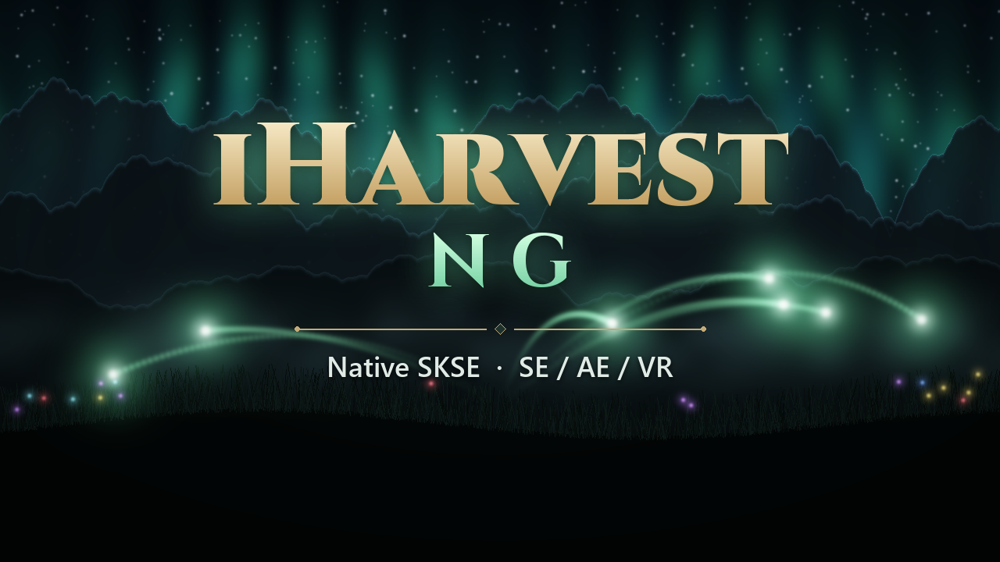
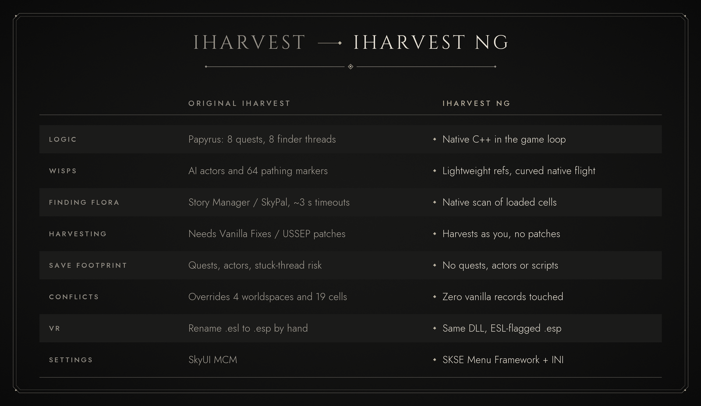

# iHarvest NG: Nexus page, copy/paste ready

Every grey box below has a **copy button** (top-right corner of the box). Paste each one into the
matching field on Nexus → *Add a mod*. Click an image to open it full size, then right-click → *Save image as*
to upload it.

---

## 1. Images (upload these)

### Header image (Nexus "Header image" slot)
[](images/banner.png)

[Download banner.png (1920×480)](https://raw.githubusercontent.com/Kexodus/iharvest-ng/main/docs/nexus/images/banner.png)

### Primary image (Nexus "Primary image" / thumbnail slot)
[](images/thumbnail.png)

[Download thumbnail.png (1280×720)](https://raw.githubusercontent.com/Kexodus/iharvest-ng/main/docs/nexus/images/thumbnail.png)

### Also upload to the Images tab
[](images/comparison.png)

[Download comparison.png (1600×980)](https://raw.githubusercontent.com/Kexodus/iharvest-ng/main/docs/nexus/images/comparison.png)

### Section headers (already embedded in the description; nothing to upload)


---

## 2. Mod name
```text
iHarvest NG
```

## 3. Version
```text
1.0.1
```

## 4. Category
```text
Gameplay
```

## 5. Author
```text
Kexodus
```

## 6. Brief overview (summary, 220/255 characters)
```text
Native SKSE remake of IHarvest: cast Harvest and wisps pick every ingredient around you. Same spell, tomes and staff, but no Papyrus, no quests, zero vanilla overrides. Works with modded flora. One DLL for SE, AE and VR.
```

## 7. Description (paste the whole box into the description editor, in BBCode mode)
The art is already embedded in it and loads from GitHub automatically.

```text
[center][img]https://raw.githubusercontent.com/Kexodus/iharvest-ng/main/docs/nexus/images/banner.png[/img]

[size=4][i]Cast [b]Harvest[/b] and little wisps fly out, pick every ingredient around you, and bring it back.
The IHarvest you know, rebuilt from scratch as a native SKSE plugin. No scripts, no quests, no conflicts.[/i][/size]

[size=3][b]One DLL for Skyrim SE 1.5.97  •  AE 1.6.x (including 1.6.1130+)  •  Skyrim VR[/b][/size][/center]

[line]

[center][img]https://raw.githubusercontent.com/Kexodus/iharvest-ng/main/docs/nexus/images/section_features.png[/img][/center]

[b]iHarvest NG[/b] is a complete native reimplementation of [url=https://www.nexusmods.com/skyrimspecialedition/mods/27789]IHarvest[/url] by IDontEvenKnow. The original relied on about 3,800 lines of Papyrus: 8 quests, Story Manager searches, and actor "critters" walking on AI packages. All of it is now C++ running inside the game loop.

[list]
[*][b]Plays the same.[/b] Same spell, spell tomes in the same 18 hand-placed spots, the same Staff of Harvest, the same skill scaling, and the same magicka-per-wisp economy.
[*][b]No Papyrus at all.[/b] Nothing backs up the script VM, there are no "Story Manager under high load" pop-ups, and no stuck threads end up in your save.
[*][b]Wisps fly natively[/b] along smooth curved paths. They aren't pathfinding actors, so they never get stuck on terrain.
[*][b]Harvests as you.[/b] Green Thumb, harvest sounds, Hearthfire planters, butterflies, fish, nirnroot and quest hooks all behave as if you'd picked by hand. No "Vanilla Fixes" patch is needed.
[*][b]Works with modded flora and ingredients automatically.[/b] There's no hard-coded list. Anything in your load order that yields an ingredient is fair game.
[*][b]Conflict-free.[/b] The plugin overrides [b]zero[/b] vanilla records, so it's safe with world map, lighting, worldspace and city mods.
[*][b]Save-safe.[/b] No quests, actors or scripts end up in your save, and wisps saved mid-flight are cleaned up on load.
[*][b]VR-ready.[/b] The plugin is an ESL-flagged .esp: light on SE/AE, and a normal plugin on VR with no renaming.
[/list]

[center][img]https://raw.githubusercontent.com/Kexodus/iharvest-ng/main/docs/nexus/images/comparison.png[/img][/center]

[center][img]https://raw.githubusercontent.com/Kexodus/iharvest-ng/main/docs/nexus/images/section_how_it_works.png[/img][/center]

[b]Getting the spell[/b]
[list]
[*][b]Spell Tome: Harvest[/b] is hidden in the original's 18 locations across Skyrim, Solstheim, Blackreach and the Soul Cairn. Once you know the spell, most of the remaining tomes quietly vanish as you find them.
[*]The [b]Staff of Harvest[/b] can be found in 4 places, or crafted at a Solstheim staff enchanter.
[/list]

[b]Casting[/b]
[list]
[*][b]Harvest[/b] is a free Alteration concentration spell. Each wisp it sends costs [b]8 Magicka[/b], reduced by Alteration cost reduction (never below 15%).
[*]The first wisp leaves instantly. After that the cast speeds up towards a limit set by your [b]Alteration[/b] and [b]Alchemy[/b]: 500 ms with no skill, about 330 ms at 100/100.
[*]The search radius also grows with your skills, from 1,500 to 4,000 units.
[*][b]Dual casting[/b] gives 1.5× radius and a faster ramp-up. [b]NG extra:[/b] with the [b]Alteration Dual Casting[/b] perk, every refire sends [b]two wisps[/b].
[*]Magicka is only spent when a wisp actually goes out. If nothing is in range, the cast simply checks again less often.
[*]Each wisp grants Alteration XP.
[*][b]Staff of Harvest:[/b] cast it to toggle hands-free harvesting with a bigger radius. It drains enchantment charge per wisp.
[/list]

[b]What gets harvested[/b]
[list]
[*]Flora and trees that yield ingredients, from the base game, the DLCs or [b]any mod[/b]
[*]Loose ingredients lying around
[*]Butterflies, moths, dragonflies and fish
[*]Nirnroot, poison blooms, wisp cores, Creation Club harvestables and Beyond Skyrim wisp stalks
[*]Optional: food, Hearthfire garden planters (on by default), and arrows and bolts
[*]Owned items are never taken (toggleable). NPCs who know the spell or carry the staff send wisps too.
[/list]

[center][img]https://raw.githubusercontent.com/Kexodus/iharvest-ng/main/docs/nexus/images/section_requirements.png[/img][/center]

[list]
[*][url=https://www.nexusmods.com/skyrimspecialedition/mods/30379]SKSE[/url] (or SKSEVR for VR)
[*][url=https://www.nexusmods.com/skyrimspecialedition/mods/32444]Address Library for SKSE Plugins[/url] (or VR Address Library for SKSEVR)
[*][i]Optional:[/i] [url=https://www.nexusmods.com/skyrimspecialedition/mods/120352]SKSE Menu Framework[/url] for the in-game settings page. Without it, everything is in an INI.
[/list]
Not required: SkyUI, PapyrusUtil, SkyPal, USSEP, or any patch.

[center][img]https://raw.githubusercontent.com/Kexodus/iharvest-ng/main/docs/nexus/images/section_installation.png[/img][/center]

[b]New install:[/b] install with your mod manager and enable [b]iHarvestNG.esp[/b]. Load order doesn't matter.

[b]Coming from the original IHarvest:[/b] the two must not run together.
[list=1]
[*]In IHarvest's MCM, click [i]Reset Mod[/i].
[*]Save, then disable and remove IHarvest.
[*]Load that save and save again (a clean save).
[*]Install iHarvest NG.
[/list]

[b]Updating iHarvest NG:[/b] just overwrite. It's safe mid-playthrough.

[b]Uninstalling:[/b]
[list=1]
[*]Stop casting and let your wisps return.
[*]Save, then remove the mod.
[/list]

[center][img]https://raw.githubusercontent.com/Kexodus/iharvest-ng/main/docs/nexus/images/section_settings.png[/img][/center]

Open [b]SKSE Menu Framework[/b] and go to [b]iHarvest NG[/b]. Changes apply live and are saved when the menu closes.
[list]
[*][b]Status & Maintenance:[/b] wisps in flight, things harvested, [i]Recall all wisps[/i], [i]Reset[/i], and a testing section that adds the spell or staff.
[*][b]Settings:[/b]
[list]
[*]Magicka, charge and XP per wisp
[*]Max wisps at once
[*]Search radius
[*]Dual Casting perk double wisps
[*]NPC casters
[*]What to harvest
[*]Ownership
[*]Spawn and return distance
[*]Flight speed (up to 20×)
[*]Sounds
[/list]
[/list]
No Menu Framework? Every option is in [i]Data/SKSE/Plugins/iHarvestNG.ini[/i], with comments.

[center][img]https://raw.githubusercontent.com/Kexodus/iharvest-ng/main/docs/nexus/images/section_compatibility.png[/img][/center]

[list]
[*][b]Compatible with everything[/b] that doesn't also give you an IHarvest spell. The plugin adds new records only and touches nothing vanilla.
[*][b]Flora overhauls and new ingredient mods[/b] work automatically.
[*][b]Not compatible with the original IHarvest[/b] or its Redux/Improved versions. Use one or the other.
[*][b]VR:[/b] the DLL supports VR, and every engine address it uses is verified against the VR Address Library. Feedback from VR players is very welcome.
[/list]

[center][img]https://raw.githubusercontent.com/Kexodus/iharvest-ng/main/docs/nexus/images/section_faq.png[/img][/center]

[spoiler]
[b]Why is there still a plugin?[/b]
The spell, tome and staff are things you own, so they have to exist in a plugin to survive in your save. SPID, SkyPatcher and similar tools can only distribute or patch records that already exist. The plugin is ESL-flagged (no load-order slot on SE/AE), has no scripts, overrides nothing, and is under 5 KB.

[b]Does it work with modded ingredients?[/b]
Yes. NG checks each object type in your game the first time it sees one, and anything that yields an ingredient gets harvested. If you add or remove ingredient mods mid-playthrough, click [i]Reset[/i] once.

[b]A modded plant or critter isn't picked.[/b]
Flora that only gives misc items (crafting materials, for example) is skipped by design, and food needs the Food option. Custom-scripted harvestables need explicit support, so post the mod name in the comments.

[b]Can I make it faster?[/b]
Raise [i]Flight speed[/i] (up to 20×), dual cast with the Alteration Dual Casting perk, and level Alteration and Alchemy.

[b]Where's the log?[/b]
Documents/My Games/Skyrim Special Edition/SKSE/iHarvestNG.log. Set the log level to "debug" under Diagnostics when reporting a bug.
[/spoiler]

[center][img]https://raw.githubusercontent.com/Kexodus/iharvest-ng/main/docs/nexus/images/section_credits.png[/img][/center]

[list]
[*][b]IDontEvenKnow[/b] made the original [url=https://www.nexusmods.com/skyrimspecialedition/mods/27789]IHarvest[/url]. All the gameplay design, records, wisp meshes and sounds are theirs, released under the WTFPL, and the mod is renamed as that license asks. Please endorse the original too.
[*][b]CommonLibSSE-NG[/b] contributors (alandtse, CharmedBaryon, powerofthree and everyone else).
[*]The [b]SKSE[/b] team, and [b]meh321[/b] for Address Library.
[*]The [b]SKSE Menu Framework[/b] team.
[/list]

[b]Source code:[/b] [url=https://github.com/Kexodus/iharvest-ng]github.com/Kexodus/iharvest-ng[/url]. iHarvest NG's code is GPL-3.0, and the reused original IHarvest assets are WTFPL. Bug reports and pull requests are welcome.
```

---

## 8. Files tab: main file

**Upload:** [iHarvestNG-1.0.1.zip](https://github.com/Kexodus/iharvest-ng/releases/download/v1.0.1/iHarvestNG-1.0.1.zip). Category: *Main Files*.

File name:
```text
iHarvest NG
```
File version:
```text
1.0.1
```
File description:
```text
Skyrim SE 1.5.97 / AE 1.6.x / VR. Install with a mod manager and enable iHarvestNG.esp. Requires SKSE + Address Library. Do not use together with the original IHarvest.
```

## 9. Requirements tab
Add these as requirements (search by name or ID):

| Mod | Nexus ID | Note to paste |
|---|---|---|
| SKSE | 30379 | `Required (SKSEVR for VR)` |
| Address Library for SKSE Plugins | 32444 | `Required (VR Address Library for VR)` |
| SKSE Menu Framework | 120352 | `Optional - in-game settings page (INI otherwise)` |

## 10. Changelog tab
Version `1.0.1`:
```text
Fixed conflicts with world-map, lighting and worldspace mods: the plugin no longer overrides any vanilla record (tomes and staves are now placed at runtime). Safe to update mid-playthrough.
```
Version `1.0.0`:
```text
First release.
```

## 11. Permissions tab
Credits (the "Credits" text box):
```text
IDontEvenKnow - the original IHarvest (WTFPL): gameplay design, records, wisp meshes and sounds. Please endorse the original too.
CommonLibSSE-NG contributors (alandtse, CharmedBaryon, powerofthree and others).
SKSE team, meh321 (Address Library), SKSE Menu Framework team.
```
Suggested toggles:
- Upload to other sites, modify, convert, use assets: **Yes, with credit** (source is GPL-3.0)
- Use in paid mods / Creation Club: **No**

## 12. Tags
```text
Alchemy, Ingredients, Spells, Magic, SKSE, Gameplay, Immersion, VR, Quality of Life
```

---

## Still to do yourself
- **In-game screenshots.** Real ones sell the mod best, and I can't take them. Good ones: dual casting in a
  flower meadow with wisps mid-flight, a wisp diving into a flower, the Staff of Harvest, the settings page.
  Use `tm` in the console to hide the UI and `tfc` for a free camera.
- Message IDontEvenKnow with the link (a courtesy, not required).

*Regenerate the art with `python tools/nexus_art.py`.*
