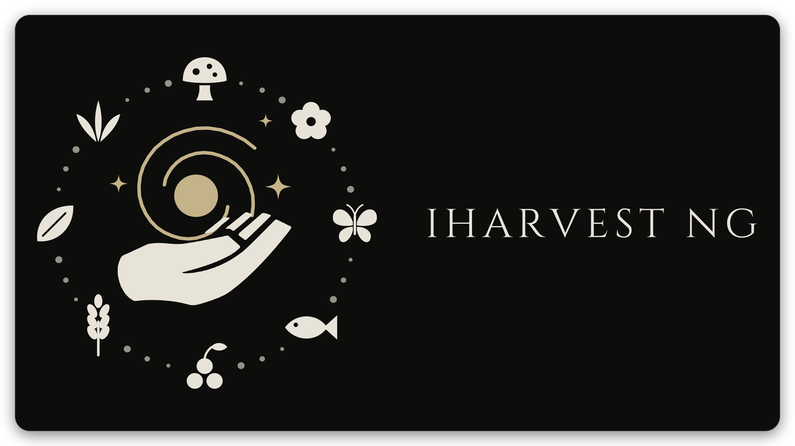
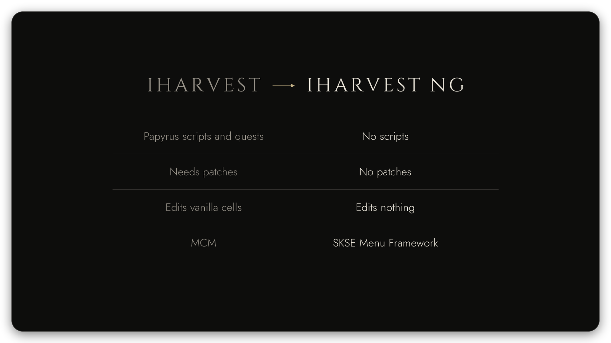

# IHarvest NG Press Kit

Art and copy for the **IHarvest NG** Nexus page. Everything here is loose files. Nothing is zipped.


## Copy-paste text

| File | Paste into |
|---|---|
| [`nexus-description.bbcode.txt`](nexus-description.bbcode.txt) | Nexus **Description** field (BBCode). Images load from this repo's `main` branch. |
| [`nexus-summary.txt`](nexus-summary.txt) | Nexus **Brief overview** (under 255 characters) |

Every other field is under [Nexus fields](#nexus-fields) below, one copy box each.

## Nexus page images

Upload these on the Nexus **Images** tab. Make the primary image the mod's **Primary image**.

| Image | Size | Use |
|---|---|---|
| [`ihng-primary-1920x1080.png`](nexus/ihng-primary-1920x1080.png) | 1920×1080 | Primary image / thumbnail |
| [`ihng-gallery-comparison-1920x1080.png`](nexus/ihng-gallery-comparison-1920x1080.png) | 1920×1080 | Gallery: original IHarvest vs NG |
| [`ihng-header-1920x480.png`](nexus/ihng-header-1920x480.png) | 1920×480 | Nexus **Header image** slot |
| [`ihng-icon-minimal-1024.png`](logo/ihng-icon-minimal-1024.png) | 1024×1024 | Optional gallery image: the icon on its own |

<p>
  
  
</p>

## Description images

The BBCode file already uses these. Each is a dark **card**: rounded corners, a hairline border and a
soft shadow on transparent margins, so the panels sit on the Nexus page like its own UI elements.

| Image | Card size | Use |
|---|---|---|
| [`ihng-banner-card.png`](nexus/ihng-banner-card.png) | 1920×480 | Top of the description |
| [`ihng-comparison-card.png`](nexus/ihng-comparison-card.png) | 1600×720 | Comparison under Features |
| `section-01-…` to `section-08-…` | 1200×112 | Section headers |


## Logo files

| File | Notes |
|---|---|
| [`logo/ihng-icon-minimal.svg`](logo/ihng-icon-minimal.svg) | **Source.** The icon on its dark background. Edit this, then re-export |
| [`logo/ihng-icon-minimal-transparent.svg`](logo/ihng-icon-minimal-transparent.svg) | The same without the background square (its cut-outs are still painted dark) |
| [`logo/ihng-icon-minimal-1024.png`](logo/ihng-icon-minimal-1024.png) | Icon on the dark background |
| [`logo/ihng-icon-minimal-512.png`](logo/ihng-icon-minimal-512.png), [`logo/ihng-icon-minimal-256.png`](logo/ihng-icon-minimal-256.png) | Avatar / icon sizes |
| [`logo/ihng-icon-minimal-transparent.png`](logo/ihng-icon-minimal-transparent.png) | Icon only, transparent background, trimmed; cut-outs are real holes (made by `src/cutout.py`) |


The icon: an open palm with a rounded wrist cut, holding a Harvest spell (a gold orb in a swirl, three
sparkles), ringed by Skyrim harvestables on a dotted circle: a fly amanita, a blue mountain flower, a
butterfly, a fish, juniper berries, wheat, a leaf and nirnroot. The transparent file is light artwork. Place
it only on dark backgrounds.

The hand is traced from ["Open palm" by Skoll](https://github.com/game-icons/icons/blob/master/skoll/open-palm.svg)
on [game-icons.net](https://game-icons.net), [CC BY 3.0](https://creativecommons.org/licenses/by/3.0/)
(see [`src/third_party/`](src/third_party/README.md)). Keep the credit wherever the icon is used; the
description and the Nexus credits box already carry it.

## Style

| Token | Value | Use |
|---|---|---|
| Background | `#0d0d0c` | Every canvas |
| Foreground | `#e8e3d8` | Icon, headings, body text |
| Dim | `#969188` | Secondary text, the icon's dotted circle |
| Accent | `#c4b288` | Magic only: the spell's orb, swirl and sparkles. Nothing else is gold. |
| Type | Cinzel (titles), Jost (body) | Uppercase titles with wide letter spacing. Both SIL OFL, in `src/fonts/` |

Keep it flat: no gradients, glows, textures, frames or extra colors. One idea per image, no taglines or spec badges.
Every image is a rounded dark card with a hairline border and a soft shadow, so it sits on the Nexus page like its own UI. Upload-slot images (header, primary, gallery) keep their exact sizes; the card is drawn inside them.
The sparkle mark in the section headers is redrawn from the icon's spell.

## Rebuild

Requires Windows, Python 3 with Pillow (`python -m pip install pillow`), and Microsoft Edge (renders the SVG).

```powershell
python presskit/src/cutout.py   # logo/ transparent cut-out from logo/ihng-icon-minimal.svg
python presskit/src/build.py    # nexus/ images (the header and primary image render the same SVG)
```

The icon lives in `logo/ihng-icon-minimal.svg`; export its 1024/512/256 PNGs alongside it when it changes.
Image copy lives in `presskit/src/build.py`. Rebuild and commit the PNGs. Nexus loads the description
images from `main`.

## Nexus fields

### Mod name
```text
IHarvest NG
```

### Version
```text
1.0.7
```

### Category
```text
Gameplay
```

### Author
```text
Kexodus
```

### Files tab: main file

**Upload:** [IHarvest.NG.zip](https://github.com/Kexodus/iharvest-ng/releases/download/v1.0.7/IHarvest.NG.zip) (GitHub shows the space as a dot; rename it to `IHarvest NG.zip` if you like). Category: *Main Files*.

File name:
```text
IHarvest NG
```
File version:
```text
1.0.7
```
File description:
```text
Skyrim SE 1.5.97 / AE 1.6.x / VR. Install with a mod manager and enable IHarvestNG.esp. Requires SKSE + Address Library. Do not use together with the original IHarvest.
```

### Requirements tab
Add these as requirements (search by name or ID):

| Mod | Nexus ID | Note to paste |
|---|---|---|
| SKSE | 30379 | `Required (SKSEVR for VR)` |
| Address Library for SKSE Plugins | 32444 | `Required (VR Address Library for VR)` |
| SKSE Menu Framework | 120352 | `Optional - in-game settings page (INI otherwise)` |

### Changelog tab
Version `1.0.7`:
```text
Fixed wisps being sent to targets they could never reach (high search radius or low flight speed cost magicka for nothing). Fixed the cast restarting every frame when out of magicka. Tomes/staves are no longer placed under the loading screen. A Spell Tome you drop yourself no longer vanishes. Sturdier save data.
```
Version `1.0.6`:
```text
Diagnostics for world map reports: the log lists every plugin that edits the Tamriel worldspace (map camera/bounds). Tomes and staves are no longer placed while the game is paused.
```
Version `1.0.5`:
```text
World map broken? IHarvest NG now detects an old IHarvest plugin (the 1.0.0 IHarvestNG.esp, or the original IHarvest / a fork) that still overrides the Tamriel worldspace, and names it in a message box on load. Remove that old mod to fix the map.
```
Version `1.0.4`:
```text
Fixed Spell Tomes / Staves of Harvest never appearing: all 22 placements were rejected at startup. Existing saves get every tome and staff the next time you enter its cell.
```
Version `1.0.3`:
```text
Fixed Respect ownership skipping items the game lets you take without stealing (e.g. in the Blue Palace as its steward).
```
Version `1.0.2`:
```text
Fixed Spell Tomes / Staves of Harvest not appearing in interiors entered through a load door (e.g. Blackreach, Anise's Cabin). Existing saves pick up any missed ones.
```
Version `1.0.1`:
```text
Fixed conflicts with world-map, lighting and worldspace mods: the plugin no longer overrides any vanilla record (tomes and staves are now placed at runtime). Safe to update mid-playthrough.
```
Version `1.0.0`:
```text
First release.
```

### Permissions tab
Credits (the "Credits" text box):
```text
IDontEvenKnow - the original IHarvest (WTFPL): gameplay design, records, wisp meshes and sounds. Please endorse the original too.
vh724 - iHarvest - Redux, the SkyPal-free rework of IHarvest.
CommonLibSSE-NG contributors (alandtse, CharmedBaryon, powerofthree and others).
Skoll - the open-palm hand in the icon (game-icons.net, CC BY 3.0).
SKSE team, meh321 (Address Library), SKSE Menu Framework team.
```
Suggested toggles:
- Upload to other sites, modify, convert, use assets: **Yes, with credit** (source is GPL-3.0)
- Use in paid mods / Creation Club: **No**

### Tags
```text
Alchemy, Ingredients, Spells, Magic, SKSE, Gameplay, Immersion, VR, Quality of Life
```

## Still to do yourself
- **In-game screenshots.** Real ones sell the mod best, and I can't take them. Good ones: dual casting in a
  flower meadow with wisps mid-flight, a wisp diving into a flower, the Staff of Harvest, the settings page.
  Use `tm` in the console to hide the UI and `tfc` for a free camera.
- Message IDontEvenKnow with the link (a courtesy, not required).
